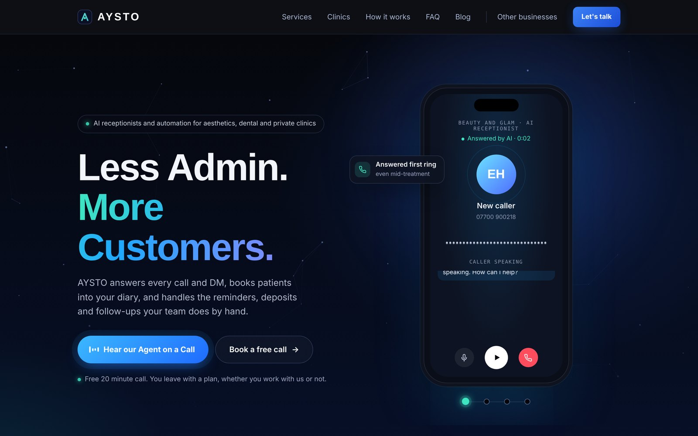
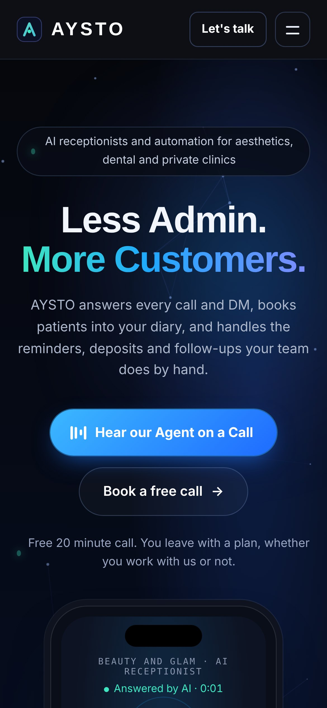
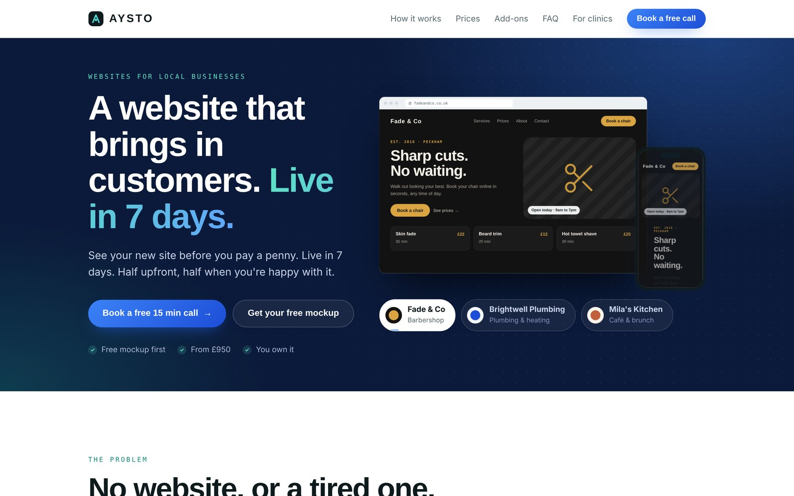
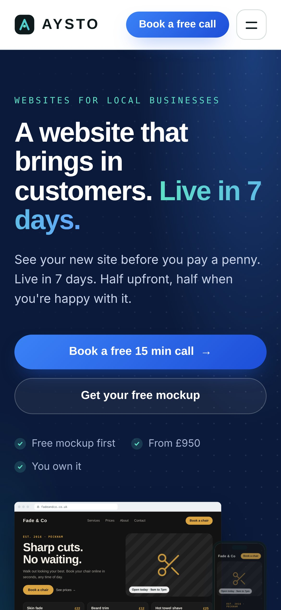
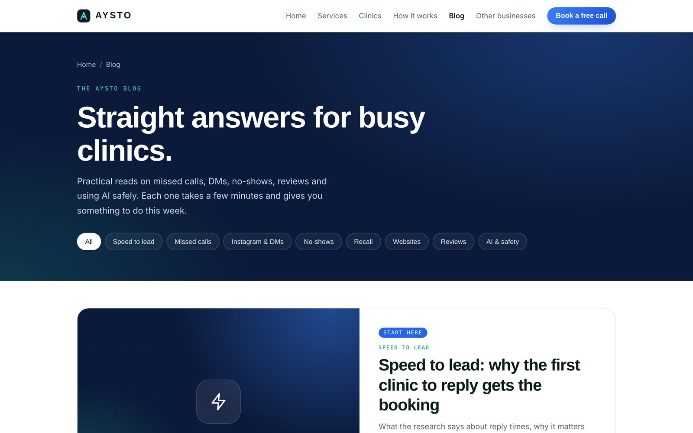

<div align="center">

# AYSTO

**AI receptionists, automation and websites for UK clinics and local businesses.**

[aystoai.com](https://aystoai.com) &nbsp;·&nbsp; [Websites for local businesses](https://aystoai.com/business) &nbsp;·&nbsp; [Blog](https://aystoai.com/blog) &nbsp;·&nbsp; [Book a free call](https://calendly.com/sdemuse1/aysto-free-call)


<br>



</div>

<br>

## Contents

- [About](#about)
- [Screenshots](#screenshots)
- [What's on the site](#whats-on-the-site)
- [Project structure](#project-structure)
- [Tech and integrations](#tech-and-integrations)
- [Configuration](#configuration)
- [Run it locally](#run-it-locally)
- [Deploy](#deploy)
- [Docs](#docs)
- [Roadmap](#roadmap)
- [Licence](#licence)

<br>

## About

AYSTO is an AI automation and web studio based in London, run by **Samuel Ayo**.

Most owner-run clinics lose bookings in the gaps: calls missed during treatments, Instagram DMs answered the next day, patients who never get a reminder. AYSTO plugs those gaps with an AI receptionist that answers every call and message, books straight into the diary, and handles reminders, deposits and follow-ups.

The site does two jobs:

| Audience | Page | Offer |
| --- | --- | --- |
| Aesthetics, dental and private clinics | [`/`](https://aystoai.com) | AI receptionist live in 14 days, then wider automation |
| Any local business | [`/business`](https://aystoai.com/business) | A website that books customers, live in 7 days. See a free mockup before paying |

<br>

## Screenshots

<table>
  <tr>
    <td width="70%"></td>
    <td width="30%"></td>
  </tr>
  <tr>
    <td align="center"><sub>Clinic homepage · desktop</sub></td>
    <td align="center"><sub>Clinic homepage · mobile</sub></td>
  </tr>
  <tr>
    <td></td>
    <td></td>
  </tr>
  <tr>
    <td align="center"><sub>/business · desktop</sub></td>
    <td align="center"><sub>/business · mobile</sub></td>
  </tr>
  <tr>
    <td colspan="2"></td>
  </tr>
  <tr>
    <td colspan="2" align="center"><sub>/blog · filterable articles for clinic owners</sub></td>
  </tr>
</table>

<br>

## What's on the site

### Clinic homepage `/`

| Section | What it does |
| --- | --- |
| **Hero** | "Less Admin. More Customers." with a phone mockup that plays a real AI receptionist call |
| **The problem** | Every missed call is a patient booking somewhere else |
| **The offer** | AI receptionist live in 14 days, founding clinic places and a 60 day guarantee |
| **What we take off your plate** | Calls, DMs, reminders, deposits, follow-ups |
| **Services** | Start with the receptionist, add automation when ready |
| **Missed call calculator** | Clinic owners enter their numbers and see what missed calls cost them each month |
| **Use cases** | Aesthetics, dental, physio and other private clinics |
| **How it works** | Up and running in weeks, not months |
| **Founder** | Who's behind AYSTO |
| **Blog** | Latest articles |
| **FAQ** | Questions clinics ask |
| **Book** | Calendly booking with an email fallback |

### Local business page `/business`

| Section | What it does |
| --- | --- |
| **Hero** | "A website that brings in customers. Live in 7 days." |
| **The problem** | No website, or a tired one, costs customers every week |
| **How it works** | See it first, pay when you're happy |
| **Prices** | Two simple packages, from £950 |
| **Add-ons** | Booking, AI chat, video and more once live |
| **Case study** | Template ready for the first client write-up |
| **FAQ** | Good questions, straight answers |
| **Free mockup form** | Request a homepage mockup before paying anything, sent through Formspree |

The page also plays a sample AI phone call for a plumbing business (`business/plumbing-call.mp3`).

### Blog `/blog`

Eight practical articles for clinic owners, filterable by topic:

| Article | Topic |
| --- | --- |
| [Speed to lead: why the first clinic to reply gets the booking](site/blog/speed-to-lead.html) | Speed to lead |
| [Where your clinic's missed calls actually go](site/blog/missed-calls.html) | Missed calls |
| ["How much for lips?" How to reply and actually get the booking](site/blog/price-dms.html) | Instagram and DMs |
| [How to cut no-shows without chasing patients](site/blog/no-shows.html) | No-shows |
| [Bringing patients back: a simple recall system for top-ups](site/blog/patient-recall.html) | Recall |
| [What your clinic website needs so visitors actually book](site/blog/clinic-website.html) | Websites |
| [How to get more Google reviews without it feeling awkward](site/blog/google-reviews.html) | Reviews |
| [Will an AI receptionist give my patients medical advice?](site/blog/ai-medical-advice.html) | AI and safety |

<br>

## Project structure

```text
aystoai/
├── site/                         # Everything Netlify publishes
│   ├── index.html                # Clinic homepage (styles and script inline)
│   ├── business/
│   │   ├── index.html            # Websites for local businesses
│   │   └── plumbing-call.mp3     # Sample AI call for a trades business
│   ├── blog/
│   │   ├── index.html            # Blog index with topic filters
│   │   └── *.html                # 8 articles
│   ├── media/
│   │   ├── clinic-call.mp3       # AI receptionist demo call (hero phone)
│   │   └── demo-call-v1.mp3      # Earlier take of the demo call
│   ├── _redirects                # /websites → /business (301)
│   ├── favicon-32.png
│   ├── apple-touch-icon.png
│   └── og-image.png              # Social share image
├── docs/
│   ├── ARCHITECTURE.md           # How the pages and scripts fit together
│   ├── BRAND.md                  # Colours, type, voice
│   ├── DEPLOYMENT.md             # Netlify, domain and DNS
│   ├── BLOG.md                   # Adding and editing articles
│   └── screenshots/
├── netlify.toml                  # Publish folder, headers, caching
├── CHANGELOG.md
├── LICENSE
├── .editorconfig
└── .gitignore
```

Every page is a single self-contained HTML file with its CSS and JavaScript inline. No framework, no bundler, no `node_modules`. Open the file, edit it, push.

<br>

## Tech and integrations

| Piece | Used for |
| --- | --- |
| **HTML, CSS, vanilla JS** | All pages. Design tokens live in CSS custom properties on `:root` |
| **Google Fonts** | Space Grotesk (headings), Inter (body), JetBrains Mono (labels) |
| **Calendly** | "Book a free call" popup and links |
| **Formspree** | Free mockup and contact forms, delivered to the AYSTO inbox |
| **Plausible** | Privacy-friendly analytics, no cookie banner needed |
| **Netlify** | Hosting, HTTPS, redirects, deploy on push |
| **ElevenLabs** | Voice for the recorded AI receptionist demo calls |

<br>

## Configuration

The clinic homepage keeps every value you're likely to change in one `CONFIG` block near the bottom of `site/index.html`:

| Key | What it controls |
| --- | --- |
| `CONTACT_EMAIL` | Inbox shown on the page and used as the booking fallback |
| `WHATSAPP` | WhatsApp number in international format. Leave blank to hide the button |
| `CALENDLY_URL` | Booking link for every "Book a free call" button |
| `FORMSPREE_ID` | Form endpoint. Until set, the form opens an email instead |
| `DEMO_CALL` | Audio file the hero phone plays |
| `FOUNDER_PHOTO` | Square photo for the founder section. Initials show until set |
| `FOUNDING_PLACES` | Founding clinic places left. `0` hides the founding offer |
| `FOUNDING_BONUS` | What founding clinics get |
| `GUARANTEE` | Guarantee text. Empty string hides it |

The `/business` page has its own `FORMSPREE_ID` near the top of its script.

<br>

## Run it locally

No install needed. From the repo root:

```bash
cd site
python3 -m http.server 8000
```

Then open [http://localhost:8000](http://localhost:8000). Use a local server rather than opening the file directly, so the folder links (`/business/`, `/blog/`) and audio files behave as they do live.

<br>

## Deploy

The site deploys to Netlify from this repo. `netlify.toml` tells Netlify to publish the `site/` folder, so there's nothing to build.

1. Push to `main`.
2. Netlify picks it up and aystoai.com updates in under a minute.

Full setup, including connecting the repo and the GoDaddy DNS records, is in [docs/DEPLOYMENT.md](docs/DEPLOYMENT.md).

<br>

## Docs

| Doc | Read it when |
| --- | --- |
| [ARCHITECTURE.md](docs/ARCHITECTURE.md) | You want to know where something lives before changing it |
| [BRAND.md](docs/BRAND.md) | You're adding a section, page or social post and want it to match |
| [DEPLOYMENT.md](docs/DEPLOYMENT.md) | Setting up Netlify, the domain or redirects |
| [BLOG.md](docs/BLOG.md) | Writing a new article |

<br>

## Roadmap

- [ ] Work section with client case studies
- [ ] Founder photo
- [ ] Clinic-specific voice receptionist demo for each niche (dental, aesthetics, physio)
- [ ] WhatsApp button once a business number is set
- [ ] More articles: deposits, aftercare messages, holiday cover

<br>

## Licence

© 2026 AYSTO. All rights reserved. The code is public so people can see how the site is built. The copy, brand, audio and design are not licensed for reuse. See [LICENSE](LICENSE).

<br>

<div align="center">
<sub>Built in London by <a href="https://aystoai.com">AYSTO</a></sub>
</div>
